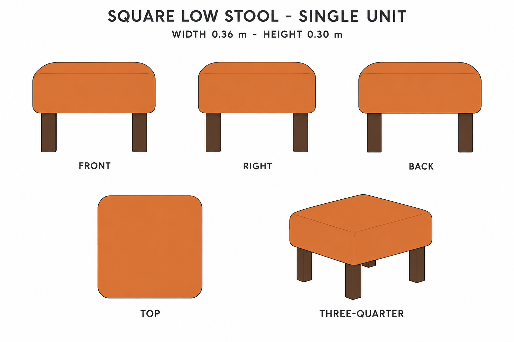
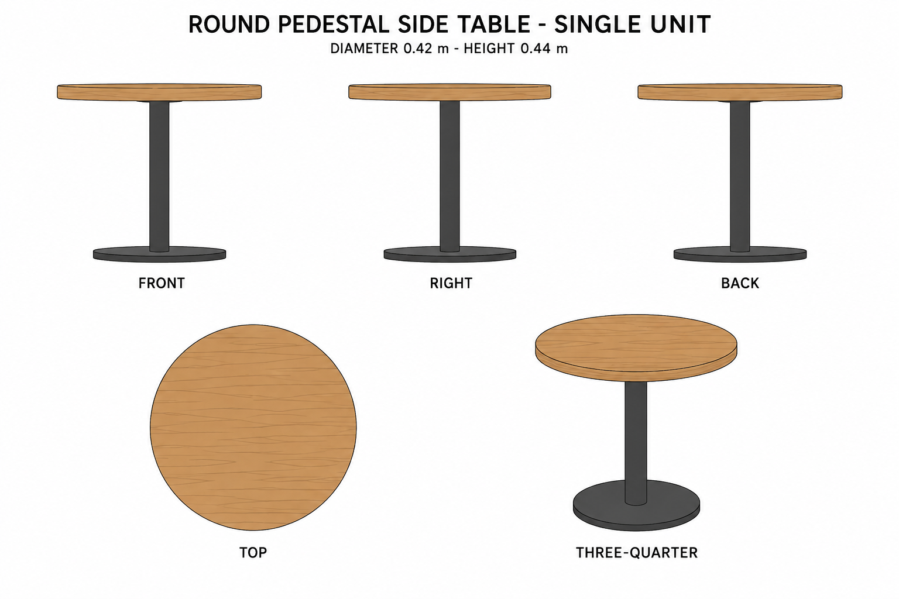

# Group 4O - Accent Furniture Review

Status: original references are approved for commit; the stool revision is approved for commit and the side table revision is approved by the user for commit. No model verification.

## Orange square low stool

## Round pedestal side table

Both units have front, right, back, top and oblique views. Review colour, silhouette and reference match. Hidden supports, four-leg count and circular table base are authored completions, not exact measurements from the source.

Use the [geometry supplement](../GEOMETRY-SUPPLEMENT.md), [JSON](../accent-furniture-model-spec.json) and [surface recipes](../SURFACE-RECIPES.md) for reconstruction. Generated front views are slightly elevated and pixel proportions are not dimensional authority. The stool's drawn top contour is not a seam. No lighting marks should become textures.

## Current stool document revision

The [stool construction specification](../SQUARE-LOW-STOOL-SPEC.md) is approved by the user
for commit. The original five views are retained. Source sizes and leg positions
remain unchanged; the document now fixes closed exterior assembly, material
regions and LOD sampling. The side table is outside this revision.

## Current side table document revision

The [side table specification](../PEDESTAL-SIDE-TABLE-SPEC.md) is approved by the user
for commit. Original source dimensions and images are preserved. Shared profile
sampling and a closed exterior replace the incomplete mixed-ring handoff.
No exported model or app rendering is claimed.
