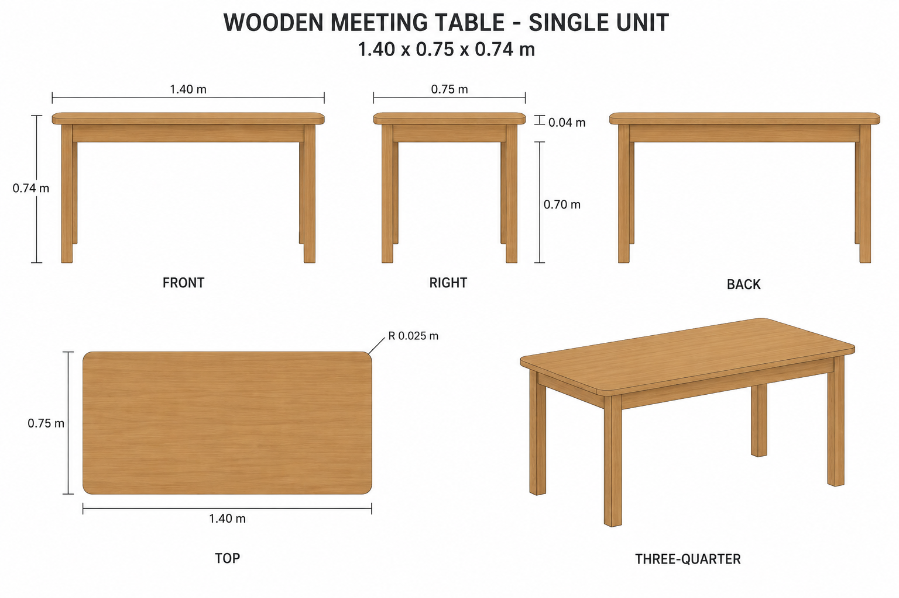
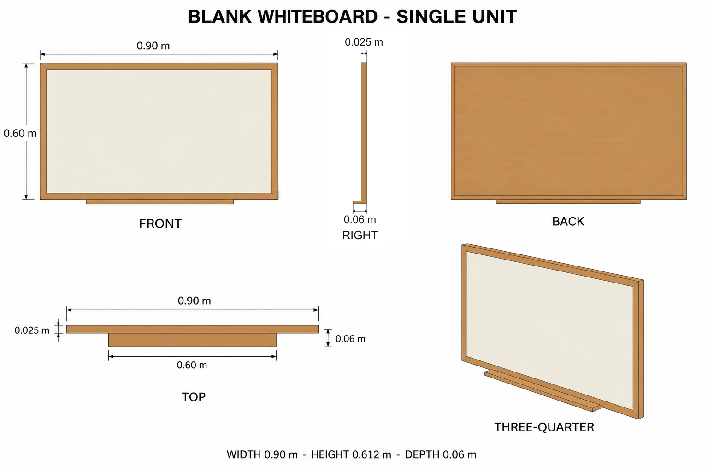

# Group 4X Review - Meeting Table and Whiteboard

Status: original reference sheets approved; meeting table document revision approved by the user for commit; whiteboard document revision approved by the user for commit.

## Wooden meeting table

One table, 1.400 x 0.750 x 0.740 m. Four straight wooden legs and four under-table aprons. No attached chairs or desk items.

## Blank whiteboard

One wall-mounted assembly. Overall XYZ size: 0.900 x 0.060 x 0.612 m including
tray (width x depth x height). The frame alone is 0.600 m high. No writing or
included stationery. The v2 sheet and whiteboard document revision are approved by the user for commit.

## Review scope

The table uses broad source-thumbnail cues; hidden construction is authored. The whiteboard is a supplementary design. Review geometry, proportions, unit boundaries and consistency between views.
Palette and surface recipes are replaceable defaults, not geometry acceptance criteria.

[Geometry](../GEOMETRY-SUPPLEMENT.md), [numeric specification](../meeting-furniture-model-spec.json), and [surface recipes](../SURFACE-RECIPES.md) define the handoff. The v2 RIGHT inset is numerically projected; the other views remain illustrative.
No model or app behavior is verified. No baked lighting belongs in model materials.
The user has approved the revised whiteboard documents and v2 sheet for commit.

## Current table construction review

The [meeting table specification](../MEETING-TABLE-SPEC.md) retains this sheet
and all original part dimensions. Nine closed components meet at sixteen flush
contacts. Analytic checks cover bounds, joints, LOD and preservation; production
geometry, visual similarity and runtime performance remain unverified. The
table revision preserved the whiteboard at that time. The table revision was
approved and committed; the current whiteboard revision below is also approved by the user for commit.

## Current whiteboard document revision

The [whiteboard construction contract](../WHITEBOARD-SPEC.md) preserves
original bounds and defaults, adds four exact mitered frame profiles, and defines
seven regions, thirteen contacts and shared geometry for all LOD tiers. The v2
sheet corrects the RIGHT inset from numeric bounds while preserving all other
view pixels. Original v1 is source history only. Revised documents and image are approved by the user for commit;
no actual model is verified. The approved table contract is unchanged.
