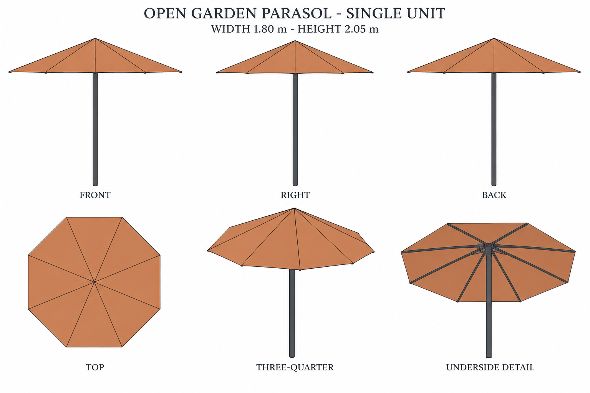
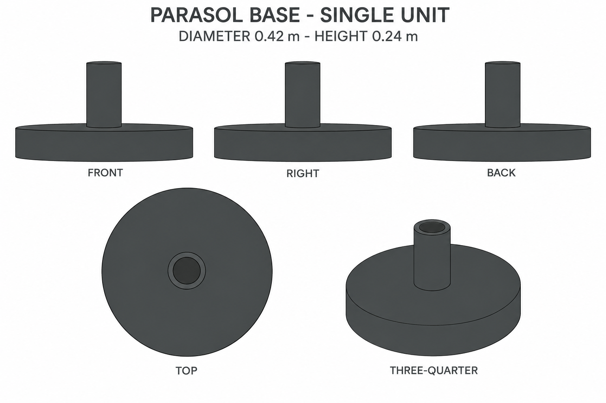

# Group 4AC Review - Garden Parasol and Base

Status: original reference sheets retained; parasol procedural construction and numeric defaults approved by the user for commit on 2026-10-10; no generated model is approved.

## Open garden parasol

One assembly without a base. Octagonal canopy, 1.800 m across opposite vertices, total height 2.050 m. Default X/Y bounds are 1.662983158520316 m with a 22.5-degree initial angle matching TOP. Static open state.

## Parasol base

One separate unit, diameter 0.420 m and height 0.240 m. Real socket bore diameter 0.037 m; no pole included.

## Review scope

These are supplementary designs. Review silhouette, palette, panel/support arrangement and independent unit boundaries. [Geometry](../GEOMETRY-SUPPLEMENT.md), [numeric specification](../outdoor-shade-model-spec.json), and [surface recipes](../SURFACE-RECIPES.md) define dimensions and hidden construction.

No baked lighting, model output, folding mechanism or app implementation. Approved for this reference handoff.

## Procedural handoff

Use the main-pole length and one branch length for all eight branches at
45-degree pitch; a downward angle defines the slope. Connect the shared root
and adjacent endpoints into eight canopy panels. Follow the geometry document
for finite thickness and concealed contacts. Independent colour/material
options apply. Do not rebuild this reference illustration or treat its unknown
camera poses as numeric measurements. Future generated multi-view and close-up
review must verify the selected construction. Base dimensions are unchanged; the construction and resizing notes below supplement its specification.

## Base specification supplement - 2026-10-10

The original base image is unchanged. Its TOP and THREE-QUARTER opening
proportions are illustrative: use the numeric 37/70 bore/socket diameter ratio,
not image measurements. The geometry document now requires a continuous
joined disk/socket boundary, an unobstructed blind bore and a closed floor.
Independent resizing invalidates the default fit assumption; inspect actual
transformed geometry before accepting an assembled pair. Programmatic generation
is suitable, but no mesh, fit implementation or model acceptance is supplied.

Base document acceptance - 2026-10-10: user approved the construction, numeric-source interpretation and resized-fit supplement for commit. No generated model or runtime fit behavior is accepted by this document approval.
