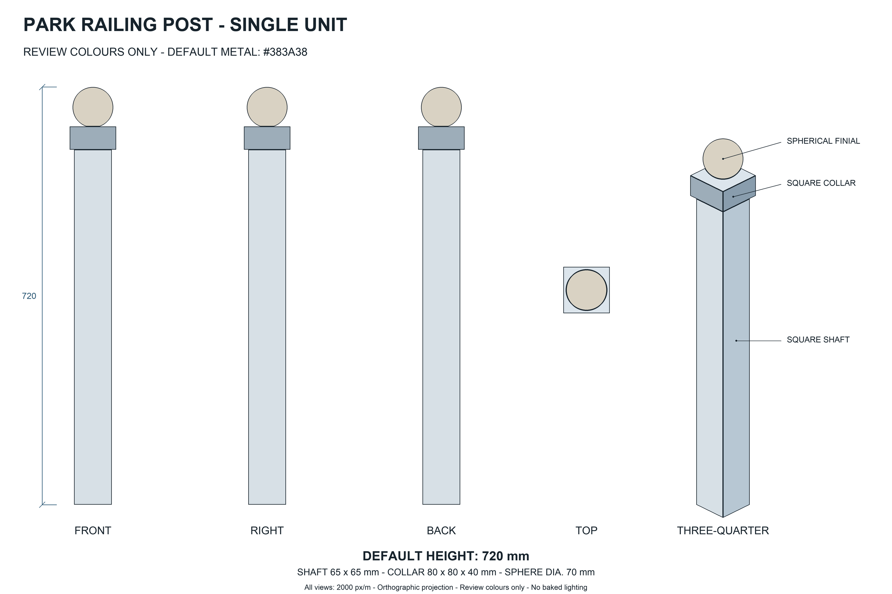
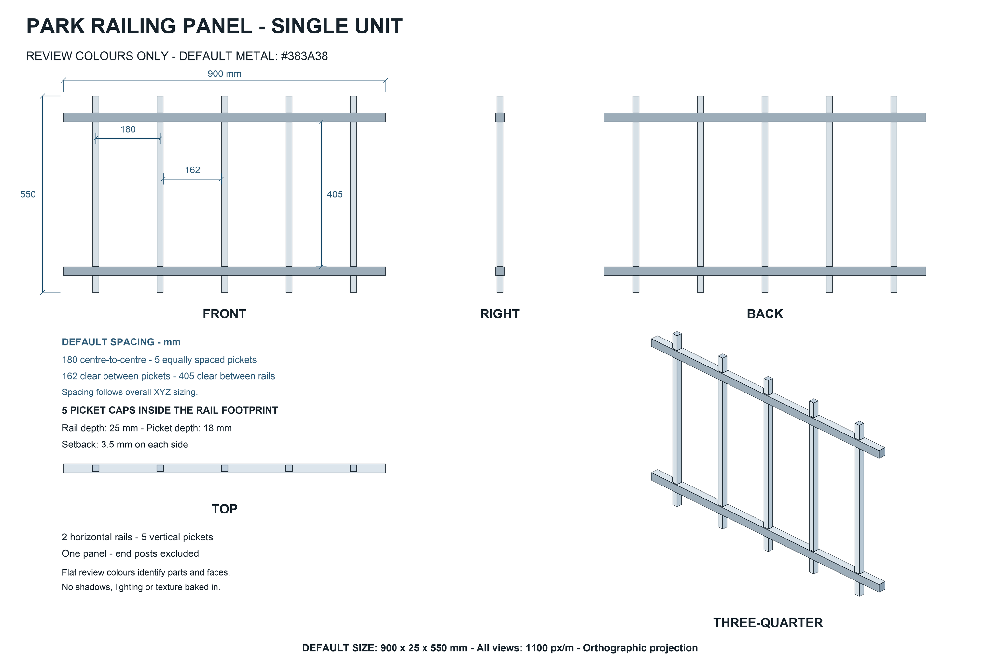

# Group 4M - Park Railing Review

Status: the post v3 revision is approved by the user for commit; panel v2 is approved by the user for commit. Drawings and specifications only; no model verification.

## One post



[Original post - silhouette source](01-railing-post-v1.png).
The default metal remains #383A38; the light review colours expose the square
shaft, square collar and spherical finial. Default full dimensions remain
80 x 80 x 720 mm. See the geometry document for the revised 65 mm shaft,
40 mm collar thickness and 2 mm joins.

## One panel



[Original panel - retained visual source](02-railing-panel-v1.png).
Panel default colour remains #383A38. V1 failed front proportions and TOP
containment: its approximately 631 x 279 px front outline gave ratio 2.262,
rather than 900/550 = 1.636, and its caps protruded beyond the rail depth.
Current v2 corrects both issues by projecting the unchanged numeric geometry.
Its light colours identify parts/faces only; they do not change the default.

Review silhouette, independent unit boundaries and suitability for repeated placement. Both sheets show five views. Front/back symmetry, hidden closed ends and numerical proportions are defined in the [geometry supplement](../GEOMETRY-SUPPLEMENT.md) and [JSON](../park-railing-model-spec.json). Current post v3 and panel v2 use numeric orthographic projections. Original image-generated sheets remain illustrative.

## Current panel v2 review

Rebuild from this directory with the existing NumPy/Pillow environment:

```sh
python3 draw-railing-panel-projections.py
```

The single 3072 x 2048 sheet uses 1100 px/m for all five views. View cameras,
source/image hashes, analytic extents, raster extents and saved-PNG measurements
are retained in [panel measurements](panel-projection-measurements.json).
No model or mesh is exported. Fixed acceptance limits are 1 px for primitive
projection boundaries and 2 px for saved-image contours. Dark contour spans
exclude the pale antialias fringe. Overall-size leaders are outside the measured
object bounds; internal blue spacing annotations are excluded by the dark-contour
threshold. No acceptance tolerance was increased to pass the drawing.

The FRONT view labels one representative 180 mm picket centre pitch, one
162 mm clear gap between adjacent pickets, and the 405 mm clear vertical opening
between the rails. Their endpoints are derived from the same part coordinates
as the drawing and recorded under `spacingAnnotations` in the measurement file.
Five pickets are equally spaced. These are default dimensions: overall X sizing
scales the pitch and horizontal gap, and overall Z sizing scales the vertical
opening. The sheet explicitly states that spacing follows overall XYZ sizing.

| Saved PNG view | Measured envelope (px) | Numeric target (px) |
| --- | --- | --- |
| Front | 990 x 605 | 990 x 605 |
| Right | 28 x 605 | 27.5 x 605 |
| Back | 990 x 605 | 990 x 605 |
| Top | 990 x 28 | 990 x 27.5 |

Front/back width-to-height ratios are exactly 900/550. All five views' raster
envelopes are within 0.348 px of their analytic extents. All five TOP caps are
inside the rail depth; their nominal 3.5 mm setbacks project to 3.85 px each.
The raster report checks both margins for every cap, and the saved PNG is read
back to verify each cap fill remains inside the rail. The lower rail is hidden
in TOP, and RIGHT correctly superimposes the five pickets.

Visual review covered the full sheet and 4x nearest-neighbour inspection of
native TOP, front and oblique joint crops. Caps are contained, rail faces
occlude hidden picket edges, and there are no added posts, disconnected joints
or cast shadows. Enlarged pixels aid inspection and are not new source detail.
This passes the scoped drawing/specification review and is approved by the user for commit;
Blender meshes, LOD, runtime materials and app behavior are not validated here.

## Superseded post v2 review

The post v2 passed part identification and label readability, but failed the
cross-view proportion review. At native 1536 x 1024 resolution, front-view
outline spans are approximately 74 px for the sphere and 80 px for the collar;
top-view spans are approximately 72 px and 83 px. The specification requires
the same 70/80 ratio in both views. The front height/collar-width ratio is about
8.3 rather than the specified 9. Stroke and antialiasing uncertainty do not
explain these differences. Do not use the earlier recolour-only pass as a full
geometry approval. V2 is not the current handoff. Two subsequent image-generation
attempts also failed the proportion check and were not selected for delivery.

## Current post v3 review

The user authorized dimension-driven drawing. Rebuild from this directory with:

```sh
python3 draw-railing-post-projections.py
```

The script uses the existing NumPy and Pillow environment. It creates one PNG
and a [measurement record](post-projection-measurements.json); no 3D model is
created. All five views share one specification and 2000 px/m scale. The original
five-view arrangement and review palette remain; no view is enlarged to fit.

Acceptance uses at most 1 px boundary error for the rasterized primitive masks
and 2 px uncertainty for saved PNG contours, including antialiasing. The top
view sphere is measured at the internal contour stroke centrelines; exterior
silhouettes are measured at their outer pixel spans. The script reads the saved
PNG and checks its principal-view dimensions, rather than recording only input
parameters. The record includes specification and image hashes.

| Saved PNG check | Front | Right | Back | Top |
| --- | --- | --- | --- | --- |
| Sphere diameter (px) | 140 | 140 | 140 | 140 |
| Collar width (px) | 160 | 160 | 160 | 160 |
| Sphere/collar ratio | 0.875 | 0.875 | 0.875 | 0.875 |
| Overall height (px) | 1440 | 1440 | 1440 | Not applicable |

All elevation height/collar ratios are 9. The five projected object envelopes
have at most 0.261 px error against analytic extents. Visual review covered the
full 3072 x 2048 sheet and 2x nearest-neighbour enlargement of the front and
oblique top assemblies: no gap, hidden collar edge through the sphere, duplicate
part, or cast shadow was found. The oblique view correctly exposes two equal-width
shaft faces and the collar top. Enlarging existing pixels is inspection, not
additional geometric evidence. Review colours, outline strokes and leaders
are annotations; the metal default remains #383A38.

This passes the scoped drawing/specification review and is approved by the user for commit.
It does not validate a Blender mesh, LOD, material rendering or app behavior.

The post collar is 0.08 square, larger than its 0.07 spherical finial. The panel contains exactly two rails and five pickets; its final rail centres are Z=0.06 and 0.49. These documented decisions resolve initial prompt and drawing ambiguities.

No shadows or highlights should be reproduced in material textures. See [surface recipes](../SURFACE-RECIPES.md).
