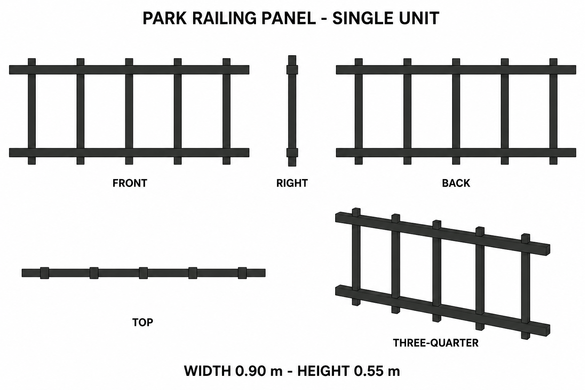

# Group 4M - Park Railing Review

Status: the post v3 revision is approved by the user for commit; the original panel approval is unchanged. Drawings and specifications only; no model verification.

## One post


[Original post - silhouette source](01-railing-post-v1.png).
The default metal remains #383A38; the light review colours expose the square
shaft, square collar and spherical finial. Default full dimensions remain
80 x 80 x 720 mm. See the geometry document for the revised 65 mm shaft,
40 mm collar thickness and 2 mm joins.

## One panel



Review silhouette, independent unit boundaries and suitability for repeated placement. Both sheets show five views. Front/back symmetry, hidden closed ends and numerical proportions are defined in the [geometry supplement](../GEOMETRY-SUPPLEMENT.md) and [JSON](../park-railing-model-spec.json). The current post v3 uses numeric orthographic projections. Original image-generated sheets, including the panel, remain illustrative.

## Superseded post v2 review

The post v2 passed part identification and label readability, but failed the
cross-view proportion review. At native 1536 x 1024 resolution, front-view
outline spans are approximately 74 px for the sphere and 80 px for the collar;
top-view spans are approximately 72 px and 83 px. The specification requires
the same 70/80 ratio in both views. The front height/collar-width ratio is about
8.3 rather than the specified 9. Stroke and antialiasing uncertainty do not
explain these differences. Do not use the earlier recolour-only pass as a full
geometry approval. V2 is not the current handoff. Two subsequent image-generation
attempts also failed the proportion check and were not selected for delivery.

## Current post v3 review

The user authorized dimension-driven drawing. Rebuild from this directory with:

```sh
python3 draw-railing-post-projections.py
```

The script uses the existing NumPy and Pillow environment. It creates one PNG
and a [measurement record](post-projection-measurements.json); no 3D model is
created. All five views share one specification and 2000 px/m scale. The original
five-view arrangement and review palette remain; no view is enlarged to fit.

Acceptance uses at most 1 px boundary error for the rasterized primitive masks
and 2 px uncertainty for saved PNG contours, including antialiasing. The top
view sphere is measured at the internal contour stroke centrelines; exterior
silhouettes are measured at their outer pixel spans. The script reads the saved
PNG and checks its principal-view dimensions, rather than recording only input
parameters. The record includes specification and image hashes.

| Saved PNG check | Front | Right | Back | Top |
| --- | --- | --- | --- | --- |
| Sphere diameter (px) | 140 | 140 | 140 | 140 |
| Collar width (px) | 160 | 160 | 160 | 160 |
| Sphere/collar ratio | 0.875 | 0.875 | 0.875 | 0.875 |
| Overall height (px) | 1440 | 1440 | 1440 | Not applicable |

All elevation height/collar ratios are 9. The five projected object envelopes
have at most 0.261 px error against analytic extents. Visual review covered the
full 3072 x 2048 sheet and 2x nearest-neighbour enlargement of the front and
oblique top assemblies: no gap, hidden collar edge through the sphere, duplicate
part, or cast shadow was found. The oblique view correctly exposes two equal-width
shaft faces and the collar top. Enlarging existing pixels is inspection, not
additional geometric evidence. Review colours, outline strokes and leaders
are annotations; the metal default remains #383A38.

This passes the scoped drawing/specification review and is approved by the user for commit.
It does not validate a Blender mesh, LOD, material rendering or app behavior.

The post collar is 0.08 square, larger than its 0.07 spherical finial. The panel contains exactly two rails and five pickets; its final rail centres are Z=0.06 and 0.49. These documented decisions resolve initial prompt and drawing ambiguities.

No shadows or highlights should be reproduced in material textures. See [surface recipes](../SURFACE-RECIPES.md).
