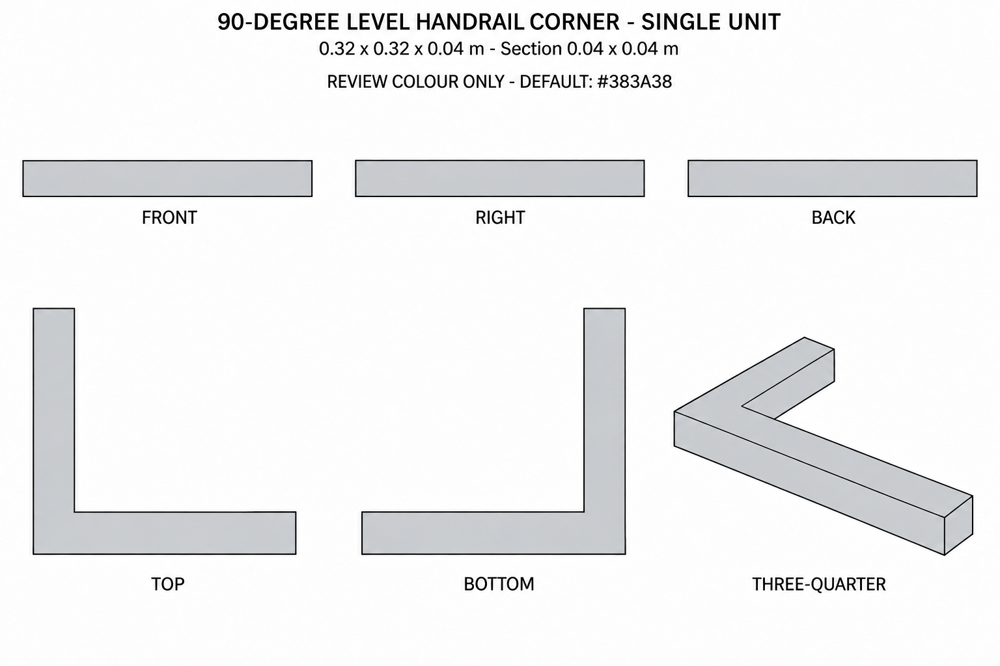

# Group 1G - Review Gallery

Status: user-approved reference sheets.

## 90-degree level handrail corner

One independent solid L-shaped component, 0.32 x 0.32 x 0.04 m overall, with equal arms and a 0.04 x 0.04 section.

The user approved the v2 light-grey review recolour on 2026-10-07. The original v1
remains the charcoal appearance reference. Geometry, dimensions and the
single-sheet layout are unchanged in intent; the numeric specification remains
the dimensional authority. The image caption distinguishes review colour from
the model default. Visual comparison found the six-view silhouettes, inner
corner, terminal faces and labels retained.

## Review scope

Confirm the single-piece L silhouette, equal arm dimensions, square section and open inner quadrant. Colour and material are replaceable defaults; the default charcoal colour is `#383A38`. Top and bottom show the complete footprint. Perspective is illustrative; numerical geometry defines equal arm lengths.

No post, floor, stair, straight rail extension or ground shadow is included. This is a supplementary design. No model or app implementation is included.

- [Geometry and connection coordinates](../GEOMETRY-SUPPLEMENT.md)
- [Surface recipes](../SURFACE-RECIPES.md)
- [Numeric specification](../railing-corner-model-spec.json)
- [Actual prompt](PROMPTS.md)

Reconstruction and model verification remain a future stage.
