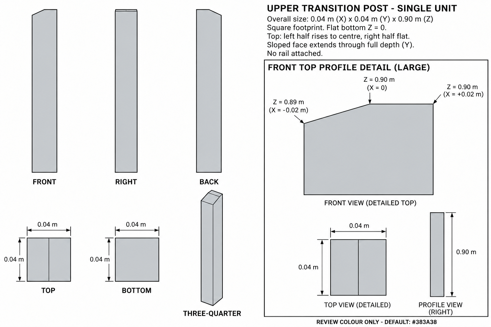
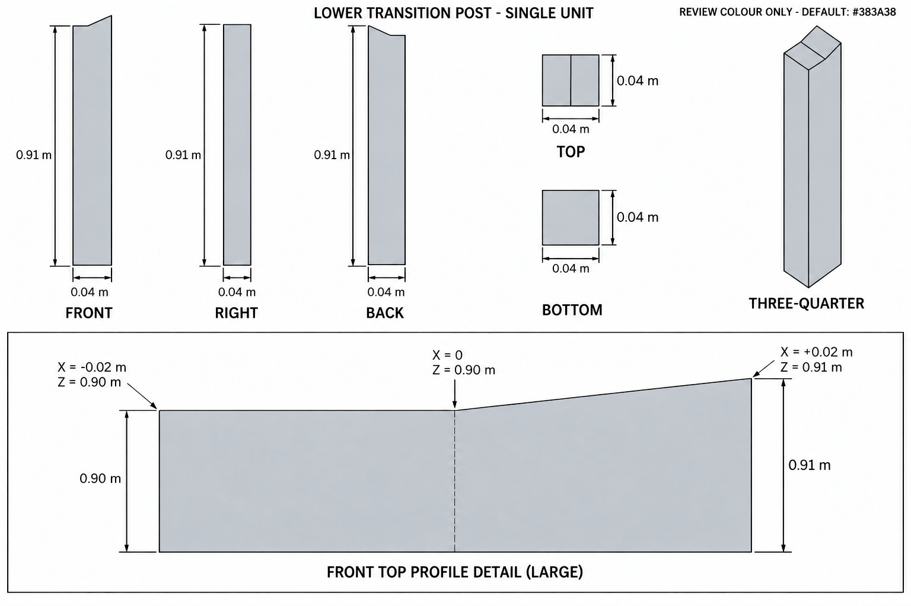

# Group 1F - Review Gallery

Status: user-approved reference sheets. Each sheet represents one independent post.

## Upper transition post

0.04 x 0.04 x 0.90 m. In front view the left top half rises, then the right half is level.

The light-grey v2 sheet was approved for commit on 2026-10-07; default material remains
charcoal `#383A38`. The original v1 image was removed. The surface recipe owns the default appearance.
See the [specification review](01-upper-transition-post-v2-review.md).

## Lower transition post

0.04 x 0.04 x 0.91 m. In front view the left top half is level, then the right half rises.

The user accepted the v14 single-sheet redraw on 2026-10-07. It is the current
lower-post reference, retaining the original six-view arrangement, annotations
and large front top-profile detail. Earlier candidate layouts are superseded.
Default colour remains `#383A38`; review grey `#C8CCD0` is an inspection aid.

See the [review record](02-lower-transition-post-review.md).

## Review scope

Confirm dimensions, the two distinct top profiles and single-unit boundaries.
Colour and material are replaceable defaults, not geometry acceptance criteria.
The default charcoal colour remains defined by the surface recipe even when a
sheet is recoloured for inspection. Neither asset includes rails, floor or stairs.
No ground shadow is included. The lower post's selected revision corrects its
full-view top profile to agree with the enlarged detail.

- [Geometry and rail connection coordinates](../GEOMETRY-SUPPLEMENT.md)
- [Surface recipes](../SURFACE-RECIPES.md)
- [Numeric specification](../railing-transitions-model-spec.json)
- [Generation and correction prompts](PROMPTS.md)

These are supplementary designs, not recovered geometry from the original image. The accepted sheets are non-calibrated appearance references. Use the documented polygons and numeric dimensions for reconstruction, not measured raster lengths or angles. No model or app implementation is included.
