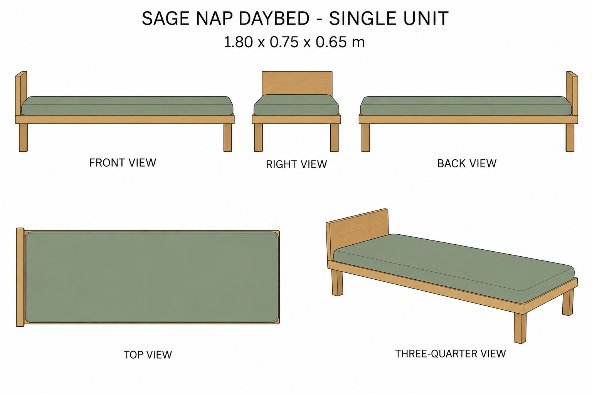
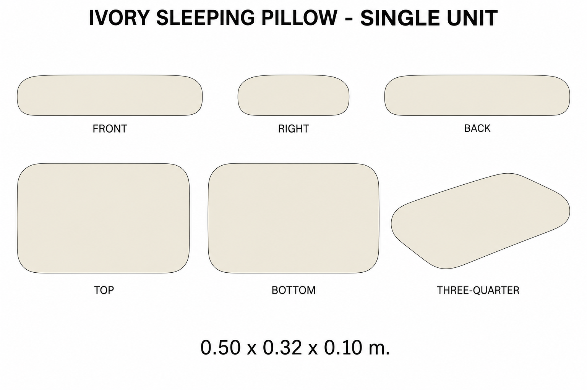

# Group 4AB Review - Nap Daybed and Sleeping Pillow

Status: original reference sheets approved; daybed document revision approved by the user for commit.

## Sage nap daybed

One independent assembly, XYZ (width x depth x height) 1.800 x 0.750 x 0.650 m. Flat padded surface at 0.420 m, four wooden legs and one headboard. No bundled pillow or blanket.

## Ivory sleeping pillow

One independent unit, 0.500 x 0.320 x 0.100 m. Plain rounded form without seams or wrinkles.

## Review scope

These are supplementary rest-area designs. Review geometry, proportions, view consistency and separate placement boundaries; colours and materials are replaceable defaults. [Geometry](../GEOMETRY-SUPPLEMENT.md), [numeric specification](../rest-furniture-model-spec.json), and [surface recipes](../SURFACE-RECIPES.md) define dimensions and hidden surfaces.

No baked lighting, model output, animation or app implementation. The revised daybed documents are approved by the user for commit.

## Current daybed construction review

The [daybed specification](../DAYBED-SPEC.md) retains this reference and all
primitive dimensions. Seven closed parts have six exact contacts. The rounded
pad has a planar central support and a 10 mm minimum gap from the headboard.
Analytic topology, bounds and LOD checks do not certify a production model.
The separate pillow has not been revised.
