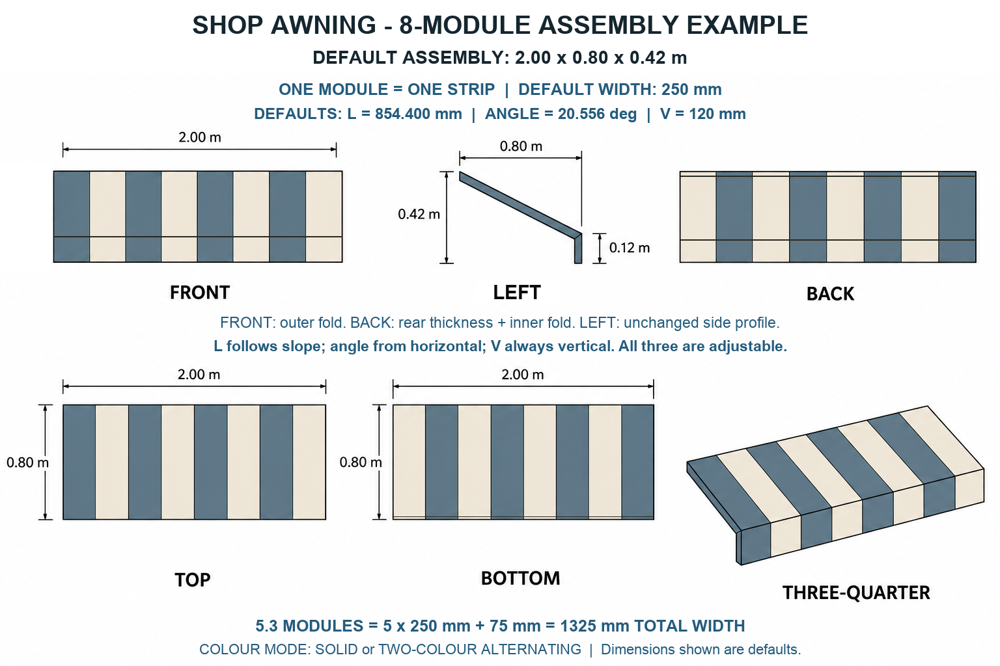

# Group 4AF - Review Gallery

Status: user-approved annotated parametric reference on 2026-10-10.
Documentation only; no generated model or app validation.

## Final reference

Eight 250 mm modules make the default 2000 mm assembly. L is the true upper
sloped length (854.400375 mm), theta is the downward angle from horizontal
(20.556045 degrees), and V is the always-vertical valance length (120 mm).
L, theta and V are independent parameters; projection and total height follow.

5.3 equivalents means five whole strips plus one 30%-width strip. Colour mode
may be solid or two-colour alternating, independently of geometry. Omitted
solid-mode colour uses blue; an explicit empty palette is rejected. The single
annotated sheet shows the default appearance, not every supported variant.

## Source preservation and authority

The [original sheet](01-striped-shop-awning-v2.png) is preserved for provenance.
Original view positions, sizes, outlines and colours are retained. FRONT now
shows its outer fold at 120 mm. BACK shows the rear lower edge at 400 mm and
inner fold at 107.5 mm, measured above the bottom. These surface intersections
make the same folded construction visible as in THREE-QUARTER; they are not
new grooves or trim. The original side view is relabelled LEFT without changing
its profile or blue colour. The former 0.42 m height label, arrows and dimension
line beside FRONT are removed; FRONT/BACK show structure without total-height
callouts. LEFT and the numeric specification retain dimension authority.
BOTTOM now shows the 20 mm valance bottom face as a narrow band along the front
edge, separated from the canopy underside by one line. Colours and the outer
outline are retained. TOP and THREE-QUARTER remain pixel-identical.

Blue notes explain configurable parameters; black surface lines distinguish
existing faces. The annotation script and preservation record accompany the PNG.
Only this final sheet is current. The original is provenance, not a second
current candidate. Exact angle/length formulas remain in the linked documents.

Drawings are uncalibrated appearance references. Exact profile formulas, joins,
input limits, final scaling and material rules belong to:

- [Geometry supplement](../GEOMETRY-SUPPLEMENT.md)
- [Numeric specification](../shop-awning-model-spec.json)
- [Surface recipes](../SURFACE-RECIPES.md)
- [Original generation prompts](PROMPTS.md)

The underside remains open, with no filled wedge or fabric side curtains.
No wall, sign, support structure, shop scene or ground shadow is included.
Future generated geometry needs its own visual and numeric review.
