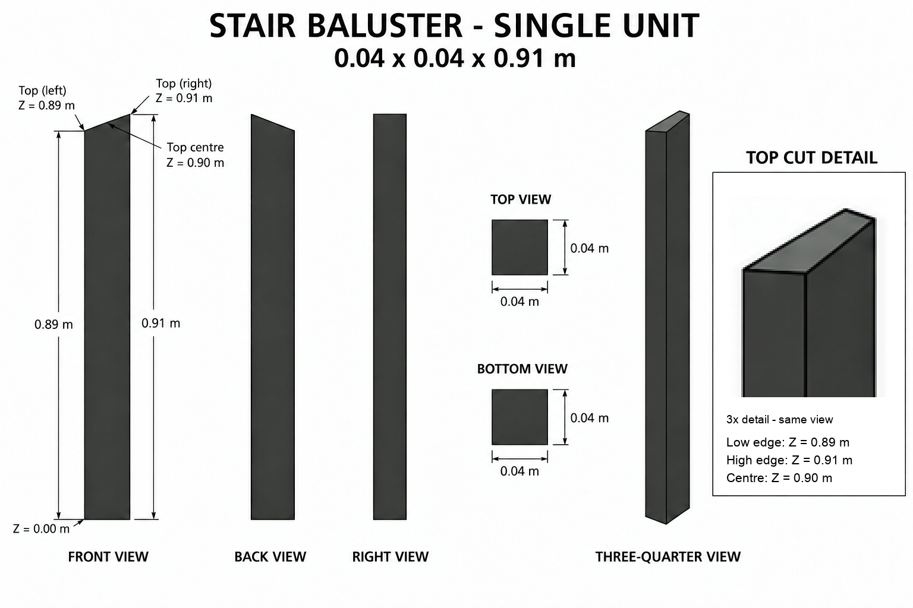
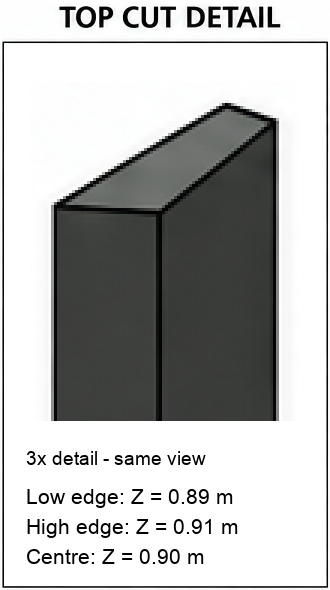
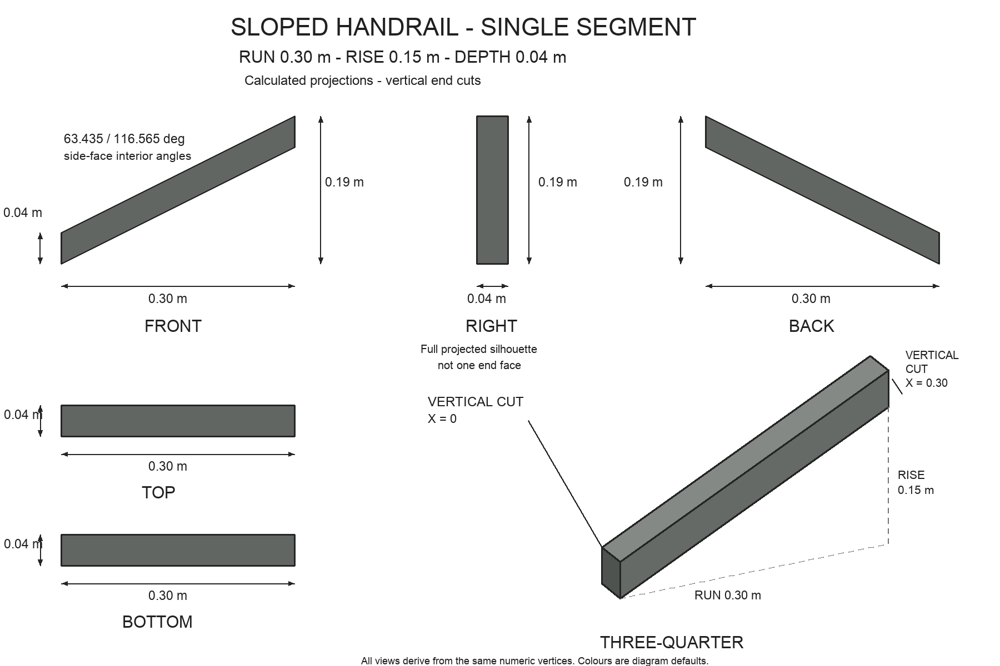

# Group 1D - Review Gallery

Status: baluster v4 was approved by the user on 2026-10-06 following the
top-cut correction. Two independently placeable components. This approval
covers the baluster drawing and documents, not a model.

## Stair baluster

One square post with a sloped top, 0.04 x 0.04 x 0.91 m overall; top centre height 0.90 m. The rear elevation is corrected to reverse the slope in screen space.

The v2 TOP CUT DETAIL is not reliable: it collapses the four-corner face into
a near-triangle. See the [geometry review](01-stair-baluster-v2-geometry-review.md)
and the [explicit top coordinates](../GEOMETRY-SUPPLEMENT.md#top-cut---explicit-geometry).
The numeric specification, not that inset, governs the sloped top.

The v3 candidate was rejected because its independently drawn inset did not
match the main THREE-QUARTER projection. Its
[review record](01-stair-baluster-v3-geometry-review.md) records that failure.
The approved v4 sheet uses a direct 3x enlargement of the main view's top.
See the [v4 review](01-stair-baluster-v4-geometry-review.md).
Earlier sheets are retained as historical evidence.

## Sloped handrail segment

One segment with 0.30 m run, 0.15 m rise and 0.04 m depth. Vertical thickness is 0.04 m; overall height including rise is 0.19 m.

The user approved the calculated v3 technical diagram on 2026-10-06. Its oblique view is derived
from the same numeric vertices as the side profile, with vertical end cuts.
The dashed run/rise construction lines are review annotations, not extra parts.
See the [geometry review](02-sloped-handrail-v3-geometry-review.md).
The earlier v1 sheet and unsuccessful imagegen v2 are historical evidence.

## Review scope

Review dimensions, silhouette, cut planes and independent-unit boundaries only,
following the shared asset review rule. Colours and materials are replaceable
defaults and do not block this geometry review. No ground or cast shadows are included.

Sheets are appearance references, not calibrated projections. Written geometry defines exact cuts and hidden surfaces.

- [Geometry and connection reference](../GEOMETRY-SUPPLEMENT.md)
- [Surface recipes](../SURFACE-RECIPES.md)
- [Numeric specification](../stair-railing-model-spec.json)
- [Actual generation and correction prompts](PROMPTS.md)

No models or app changes are included. Model reconstruction and verification remain a later stage.
