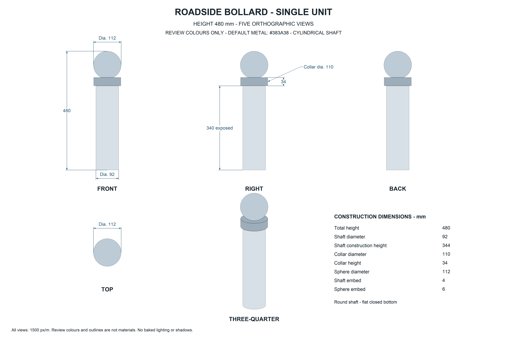

# Group 4N - Street Details Review

Status: the user approved street-sign v6. Its documents have completed final consistency review. The user approved bollard v3 and authorized committing its revised dimensions and reference sheet. See BOLLARD-REVIEW.md for measurements. Reference approval does not establish model verification. No push is authorized.

## Complete street sign

[Original street-sign reference](01-street-sign-v1.png) is retained for comparison.
All five v6 views are computed from the unchanged dimensions. RIGHT end faces
are centred; TOP exposes the four square collar corners at the same scale.
See the [current lettering review](STREET-SIGN-LETTERING-REVIEW.md) and
[retained proportion evidence](STREET-SIGN-PROPORTION-REVISION.md).
The [v2 correction record](STREET-SIGN-REVISION.md) is superseded.

## One roadside bollard

[Original bollard](02-roadside-bollard-v1.png) remains the comparison source.
See the [bollard proportion correction and document review](BOLLARD-REVIEW.md).

Both drawings show front, right, back, top and oblique views. Review appearance and independent unit boundaries. Sign lettering, hidden faces and exact dimensions are defined in the [geometry supplement](../GEOMETRY-SUPPLEMENT.md) and [JSON](../street-details-model-spec.json). The final sign is unbordered; its finial defaults to charcoal. The current light face colours and dark lettering are review-only colours, not material defaults. V6 derives its lettering directly from the original FRONT reference. The invented stroke alphabet is rejected.

The sign v6 and bollard v3 use computed projections. Original v1 sheets remain
illustrative comparison sources; their superseded dimensions do not govern construction. None of these sheets is a production texture map. No lighting marks should become material features.
