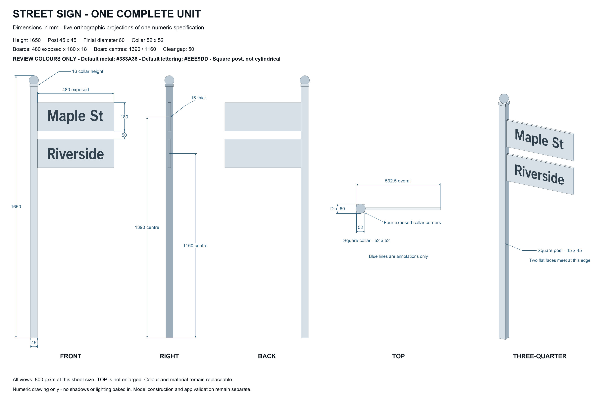
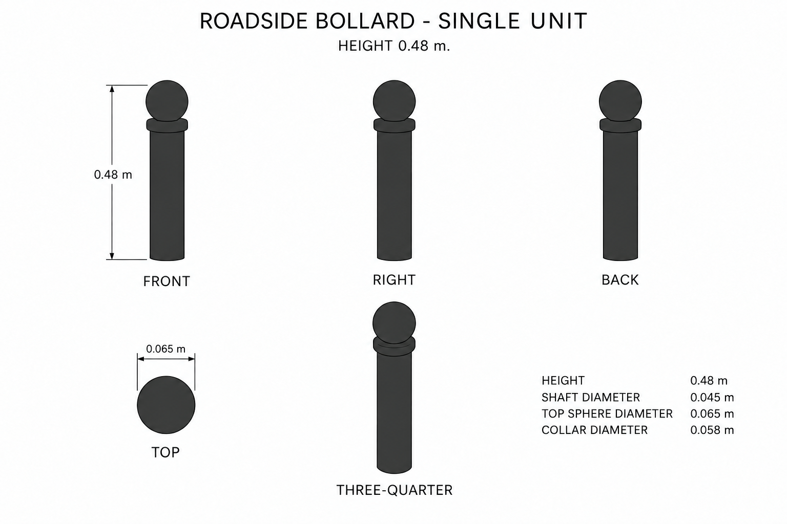

# Group 4N - Street Details Review

Status: the user approved street-sign v6. Its documents have completed final consistency review. The bollard is unchanged. Reference approval is not model verification or commit/push authorization.

## Complete street sign

[Original street-sign reference](01-street-sign-v1.png) is retained for comparison.
All five v6 views are computed from the unchanged dimensions. RIGHT end faces
are centred; TOP exposes the four square collar corners at the same scale.
See the [current lettering review](STREET-SIGN-LETTERING-REVIEW.md) and
[retained proportion evidence](STREET-SIGN-PROPORTION-REVISION.md).
The [v2 correction record](STREET-SIGN-REVISION.md) is superseded.

## One roadside bollard

Both drawings show front, right, back, top and oblique views. Review appearance and independent unit boundaries. Sign lettering, hidden faces and exact dimensions are defined in the [geometry supplement](../GEOMETRY-SUPPLEMENT.md) and [JSON](../street-details-model-spec.json). The final sign is unbordered; its finial defaults to charcoal. The current light face colours and dark lettering are review-only colours, not material defaults. V6 derives its lettering directly from the original FRONT reference. The invented stroke alphabet is rejected.

The sign v6 uses computed projections; the original sign and bollard remain
illustrative. None of these sheets is a production texture map. No lighting marks should become material features.
