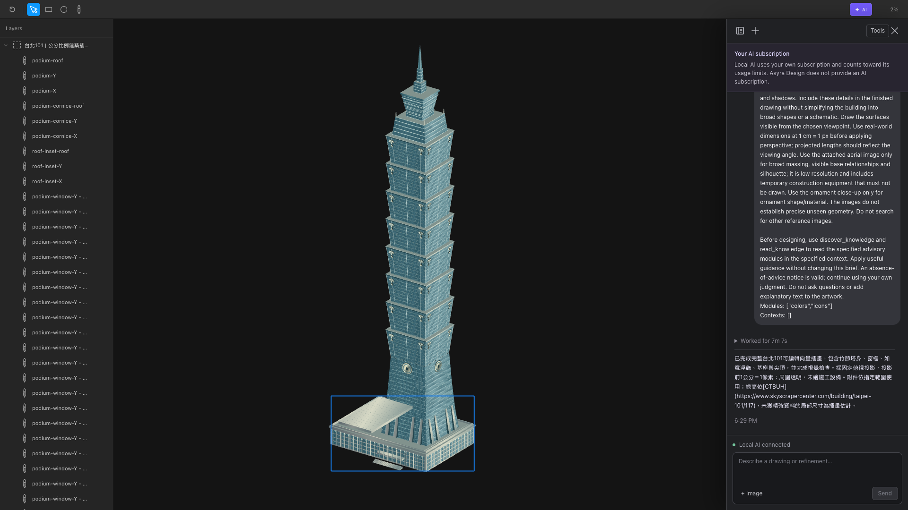
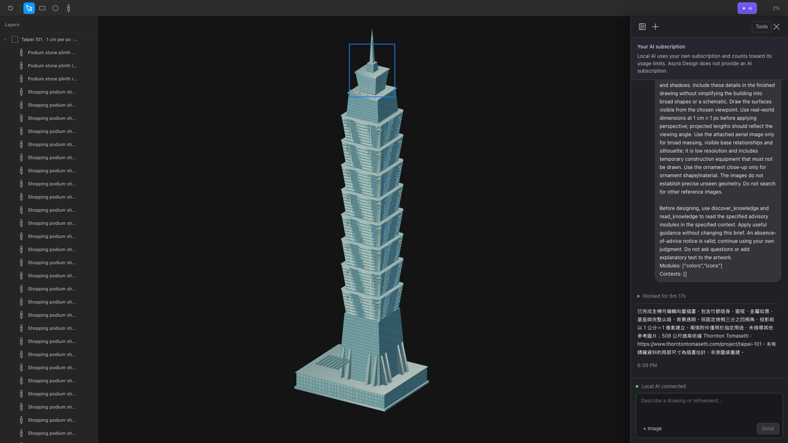
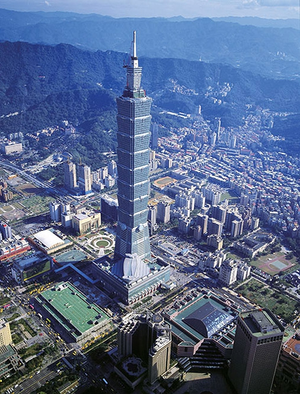

# Domain Knowledge content-quality evaluation - 2026-10-18

Status: paused at the user-requested consolidation checkpoint. Evidence is saved; final helper lint and closing review remain pending.

## Question and current conclusion

Does delivering existing advisory content improve actual Design output quality,
when the model, App prompt, tools, brief and starting document stay fixed?

The repeated small-case comparison has not demonstrated a quality improvement.
All sixteen outputs meet the fixed content/dimension/persistence checks and the
four coarse visual criteria. This is a ceiling result in these tasks, not proof
that knowledge never helps. No Knowledge Module has been added or changed.
Human blind preference review remains pending; Codex's visual ratings are
non-blind exploratory observations.

## Intervention and fixed conditions

- Base commit: `3d503aa714336946839374dc948e9c171cfb8182`.
- Model: `gpt-6-astra`, effort `medium`; no secondary model grader.
- Control: actual discover/read path, same module metadata, explicit absence notice
  instead of advice bodies. Knowledge: actual existing Markdown bodies.
- Both arms receive exactly the same instruction to read the selected modules.
  This measures content delivery, not spontaneous discovery/adoption. Metadata
  still supplies topic cues to the control.
- Case prompts, selected contexts, read instructions and App source hashes match.
  Each sample starts a fresh document/request. The condition order is interleaved.
- Three samples per arm for dense information and documentation actions. One
  independent A/B pair each for clinic information and query documentation.
- Exact text, size, editable canonical records and durable save are checked
  separately from visual quality. Node count is never a quality score.
- No favorable retries. All captures and failures are retained. Local-only live
  outcomes are not CI assertions.

The frozen cases and criteria are in
`apps/asyra-design/test-data/knowledge-evaluation/quality-cases.json`.
Four criteria use 0 (clear defect), 1 (named usable weakness), 2 (clear and
context-appropriate). A score of 8/8 means only that these four coarse criteria
were satisfied; it does not certify perfect design, accessibility or reference
fidelity. The evaluator inspected each full screenshot at 100% display zoom.

## Small-case outcomes

| Case | Samples per arm | Control observed seconds | Existing-content observed seconds | Quality result |
| --- | --- | --- | --- | --- |
| Dense information | 3 | 52.342, 48.420, 50.408 | 45.306, 52.456, 48.341 | All 8/8; no consistent named improvement |
| Documentation actions | 3 | 76.735, 66.640, 51.337 | 69.548, 50.452, 72.553 | All 8/8; no consistent named improvement |
| Independent clinic information | 1 | 50.425 | 44.341 | Both 8/8; no demonstrated gain |
| Independent query documentation | 1 | 95.061 | 79.863 | Both 8/8; distinct action hierarchy choices, both usable |

These are Send-to-observed-UI-settlement durations, not model thinking time or a
causal speed claim. All 16 have exact requested text and dimensions, no observed
browser errors, complete provider streams with zero recording failures, no
incomplete captured tool calls and matching persistence/durable sequences.
Actual read payloads confirm that controls received absence notices and knowledge
arms received advice. The normal UI and editable document APIs were used.

Concrete comparisons: the event samples retain clear title/date/location/body/
notice/action grouping in both arms. Documentation samples associate Copy with
code and distinguish continuation actions in both arms. In the independent query
case, control emphasizes Copy while knowledge emphasizes the playground; the
brief does not define one as mandatory, so this is not scored as an error.

## What is and is not established

Retrieval is working. The selected generic advice does not show a stable quality
benefit in the repeated cases; the model already produces clear results without
those bodies. A successful read or a stylistic difference cannot prove benefit.
These relatively straightforward tasks and coarse criteria limit sensitivity.
The held-out cases were not used to tune content. Existing exact geometry and
non-target editing evidence belongs to the earlier adoption report, not a new
quality-effect claim.

The 101 comparison is exploratory and has only one sample per arm. The reference
bytes and permitted use are fixed, but the agent still chooses geometric estimates,
view angle and construction strategy. Compare named visible defects; do not use
counts, elapsed time or the agent's own completion claim as a quality score.

## References and capture limitations

The fixed 507 x 665 aerial supports broad massing, silhouette and visible podium
relationships. It contains temporary construction equipment and lacks facade
resolution. The 500 x 518 ornament image supports the ornament's shape/material,
not its building placement or scale. Neither proves precise hidden geometry.
The original bytes and hashes are retained. No additional image search is allowed
in either 101 brief; text research is not disabled.

The 101 control reached UI success at 427.985 seconds and saved first/final images,
but post-settlement full snapshot capture closed the browser context. Its original
run remains a capture failure. The backend read route recovered a 173,726,940-byte
canonical checkpoint at sequence 614 without replaying the agent. This is saved
state evidence, not proof of equality with the interrupted in-memory snapshot or
successful browser reload. Exact browser termination cause is unproven. The
collector requested duplicate element/document data in one browser RPC; subsequent
large capture uses the existing streamed backend read route after a persistence
receipt. This post-settlement collector change does not alter drawing inputs.

## Decisions

Keep all existing Knowledge content unchanged unless the full comparison confirms
a missing or misleading principle connected to an actual output defect. Do not
add a building-specific answer, a module merely to fill a category, or claim a
quality improvement from retrieval. No new runtime infrastructure, drawing feature,
model, permission path or automatic knowledge evolution is introduced.

No goal was created. Every 101 request has a separate 600,000 ms forced termination
deadline from Send. No push, PR or monitoring is performed.

## Taipei 101 observed results

| Condition | First visible content, screenshot retained | UI settlement | Evidence status |
| --- | --- | --- | --- |
| Control - advice bodies absent | 104.865 s | 427.985 s | Final image and complete provider I/O retained; browser snapshot capture failed; backend checkpoint recovered separately |
| Existing Knowledge - colors and icons | 71.585 s | 377.422 s | Final image, complete provider I/O, recording and receipt-matched checkpoint retained |

Both drawings settled before the 600-second deadline. Both provider streams
completed with zero recorded failures and no incomplete captured tool calls.
The second checkpoint is 166,380,081 bytes, generation 0, durable sequence 727;
the browser confirmed sequence 727. Control lacks the corresponding browser
persistence receipt, so its backend recovery is reported separately.

Both recorded files can load media metadata without an error: 1920 x 1080,
450.36 seconds for control and 392.16 seconds for Knowledge. Their duration extends
more than ten seconds beyond observed completion. This is not a frame-by-frame
video certification. The original control failure is not overwritten.

Exploratory overview scores are [2, 2, 1, 1] for both: recognizable tower and
consistent visible projected edge families, but approximate podium/roof spatial
relationships and stylized glass. Control is comparatively uniform; Knowledge
adds conspicuously repetitive bright reflection marks. More reflection is not
necessarily better material realism. Exact hidden geometry and source-space detail
are not certified by these overview scores. No stable content-quality improvement
is established from this single pair, and the earlier capture failure further
limits complete acceptance claims.

The current colors/icons modules contain general color-role and icon-family
advice, not architectural mass decomposition or facade reflection modeling. That
coverage gap is a hypothesis for a later bounded content experiment, not proof that
adding a particular principle would repair these outcomes. The reference resolution,
agent interpretation and drawing strategy remain confounders. No content is added
merely to produce a positive result.

### Original final outputs

Control - advice bodies absent:

Existing Knowledge:

### Fixed final references

The two original images were used in both arms with the declared restrictions.

<a href="https://www.onenessarchitects.com/project/Taipei-101" target="_blank" rel="noopener noreferrer">Aerial source</a>

<a href="https://commons.wikimedia.org/wiki/File:Taipei.101.ruyi.altonthompson.jpg" target="_blank" rel="noopener noreferrer">Ornament source</a>

## Retained artifacts and remaining work

`apps/asyra-design/test-data/knowledge-evaluation/evidence/quality-2026-10-18/`
contains all 16 unchanged small-case screenshots, randomized gallery labels and
condition key, canonical check receipts, both 101 first/final images, fixed source
images, exact 101 brief, source hashes and captured-call references. The gallery
has been rendered and inspected. Human preference review is pending.

Raw recordings, full I/O and large checkpoints remain under the worktree's
`tmp/knowledge-evaluation/` and `apps/asyra-design/tmp/ai-executions/` directories.
They must not be discarded. No additional model run is needed to finish the current
report. Seven deterministic analyzer/capture/content-receipt tests passed. Final
scoped lint, naming, README synchronization and closing diff/Inspector review remain
pending at this user-requested stop. No full local CI was run in this quality phase.

All temporary advice bodies have been restored exactly; the actual Knowledge files
are clean relative to HEAD. Owned services on ports 3307, 4117 and 4217 were stopped
and the ports verified closed. Local environment files are preserved. No commit,
push, PR, new goal or monitoring was created.
